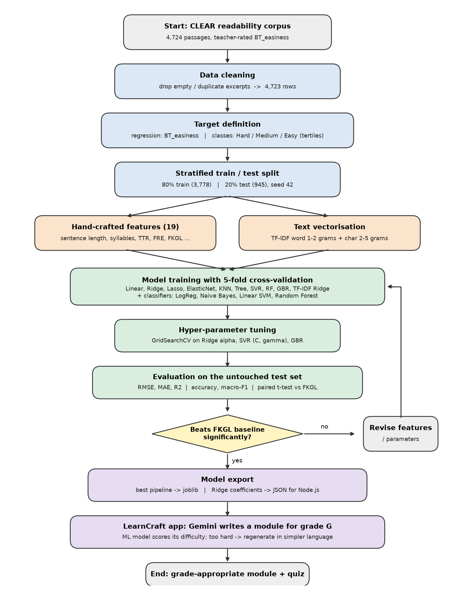

# LearnCraft AI: readability-aware study assistant

**Statistical Machine Learning Lab, Milestone 3 (final project)**
Vishwas Singh (S25CSEU0018) · Yagnesh (S25CSEU0031) · Kushal (S25CSEU0016)
UN SDG 4: Quality Education

LearnCraft AI rewrites a syllabus topic for a chosen school grade using Google Gemini and then builds a short
quiz based on Bloom's taxonomy. The hard part is checking whether the generated text is *actually* easy enough
for that grade. For the final milestone we trained statistical ML models on **4,723 teacher-rated passages**
(the CommonLit CLEAR corpus) to predict reading difficulty. The best model is far more accurate than the
Flesch-Kincaid formula we used at mid-term, and a light version of it runs inside the app, where it triggers a
"too hard? rewrite it simpler" loop.

| | Test RMSE ↓ | Test R² ↑ |
|---|---|---|
| Flesch-Kincaid grade (linear fit), mid-term baseline | 0.936 | 0.21 |
| Gradient Boosting on 19 hand-crafted features (tuned) | 0.816 | 0.40 |
| **Ridge on TF-IDF + 19 features (tuned), best** | **0.675** | **0.59** |
| Ridge on 19 features (deployed in the app) | 0.849 | 0.35 |

Three-class (Hard / Medium / Easy) accuracy: **63.3%** with logistic regression (chance = 33%).
A paired t-test over the 5 CV folds against Flesch-Kincaid gives p ≈ 2.6 × 10⁻⁶.

---

## Deliverables

| File | Description |
|------|-------------|
| [`LearnCraft_AI_Final_Project_Report.pdf`](LearnCraft_AI_Final_Project_Report.pdf) / [`.docx`](LearnCraft_AI_Final_Project_Report.docx) | Final report (TNR 12, 1.5 spacing, methodology flowchart in Ch. 3) |
| [`LearnCraft_AI_Final_Presentation.pptx`](LearnCraft_AI_Final_Presentation.pptx) | 15-slide presentation |
| [`results/`](results) | `metrics.json`, result tables (CSV), all figures, app screenshots |
| [`models/`](models) | Trained models (`best_regressor.joblib`, `ridge_features.json`) |
| [`midterm/`](midterm) | Mid-term report, slides and EDA (PDF), kept for reference |

## Methodology



1. **Data:** the CLEAR corpus (`dataset/clear_corpus.csv`). Target is `BT_easiness`; classes are its tertiles.
2. **Split:** stratified 80/20 (3,778 / 945), seed 42. All tuning uses 5-fold CV on the training part only.
3. **Features:** 19 hand-crafted linguistic features (`ml/features.py`) plus TF-IDF word 1–2-grams and
   character 2–5-grams.
4. **Models:** mean and FKGL baselines; OLS, Ridge, Lasso, Elastic Net, KNN, SVR, Decision Tree, Random
   Forest, Gradient Boosting, TF-IDF Ridge variants; classifiers (LogReg, RF, Naive Bayes, Linear SVM);
   PCA and K-Means.
5. **Tuning:** GridSearchCV on Ridge α, SVR (C, γ, ε) and Gradient Boosting.
6. **Evaluation:** RMSE / MAE / R², accuracy / macro-F1, confusion matrix, paired t-test, residual analysis,
   permutation importance, learning curve.
7. **Deployment:** the Ridge model is exported to JSON and run in JavaScript (`shared/readability_ml.js`),
   checked against Python by `ml/check_js_parity.js`.

## Project structure

```
ml/
  features.py            19-feature extractor (+ sklearn helpers)
  train.py               trains every model, writes results/ and models/
  check_js_parity.js     verifies the JS port matches Python
shared/
  readability_ml.js      feature extractor + Ridge predictor (Node, browser, Next.js)
  ridge_model.js         exported model for the zero-install demo page
  learncraft_content.js  sample lessons/quizzes and UI helpers used by both front ends
dataset/                 CLEAR corpus + extracted features (see dataset/README.md)
models/                  trained models
results/                 metrics.json, CSV tables, figures/, screenshots/
backend/                 Express API + Gemini integration + adaptive regeneration loop
index.html               the app, zero-install: Learn tab + Check-any-text tab (open in a browser)
frontend/                the same app in Next.js 14 + Tailwind (imports ../shared and ../models)
scripts/                 generate the report, slides, flowchart and architecture diagram
midterm/                 mid-term report, slides and EDA PDF, kept for reference
```

## How to run

**1. Reproduce the ML results** (Python 3.10+, about 6 minutes on a laptop)
```bash
pip install -r requirements.txt
python ml/train.py
node ml/check_js_parity.js
```

**2. Run the app**
```bash
cd backend
npm install
node server.js          # http://localhost:5000
```
Then open `index.html` in a browser (or double-click `start_demo.bat` on Windows).

Prefer the Next.js version? It has the same features:
```bash
cd frontend
npm install
npm run dev             # http://localhost:3000
```
Set `NEXT_PUBLIC_API_URL` if the backend is not on `http://localhost:5000`.
A Gemini key is optional: copy `backend/.env.example` to `backend/.env` and set `GEMINI_API_KEY`.
Without a key the backend uses a built-in simulator, so everything still works offline.

**API endpoints:** `POST /api/generate-module`, `POST /api/generate-quiz`, `POST /api/analyze-reading-level`,
`GET /api/curriculum-topics`, `GET /api/health`. The readability endpoint now returns `mlEasiness`,
`mlDifficulty`, `mlGradeBand` and `mlReliable` next to the classical Flesch scores. `generate-module`
returns an `adaptiveCheck` object showing whether the text was regenerated.

**3. Rebuild the report and slides** (Windows with MS Word, for the PDF step)
```bash
python scripts/generate_flowchart.py
python scripts/generate_architecture_final.py
python scripts/generate_final_report.py
python scripts/docx_to_pdf.py LearnCraft_AI_Final_Project_Report.docx
python scripts/generate_final_presentation.py
```

## Known limitations

- The model is trained on 140–200-word passages. Inputs under 80 words are flagged as low confidence.
- The Hard/Medium/Easy to grade-band mapping is approximate (CLEAR has no per-passage grade).
- The adaptive loop has been tested end to end with the offline simulator, not in a classroom study.

## Data licence and credits

CLEAR corpus © CommonLit / Crossley et al., CC BY-NC-SA 4.0, used here for non-commercial academic work.
See `dataset/README.md`. Our code is released under the MIT licence.
